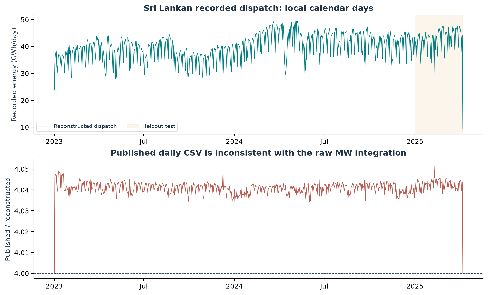
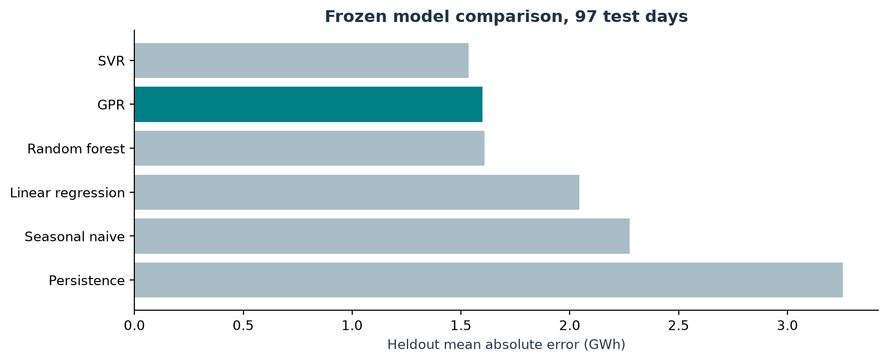
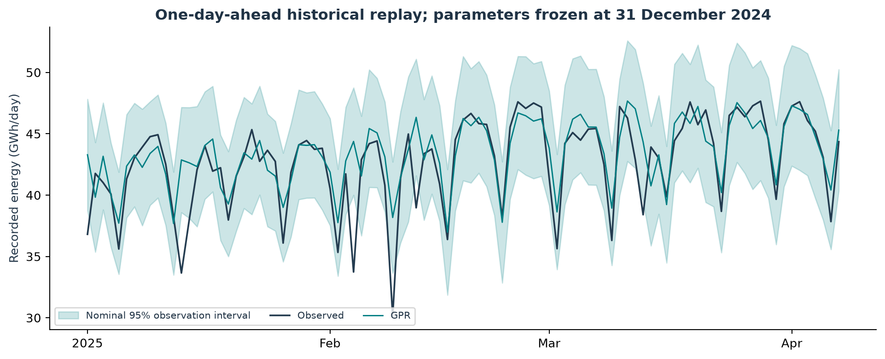
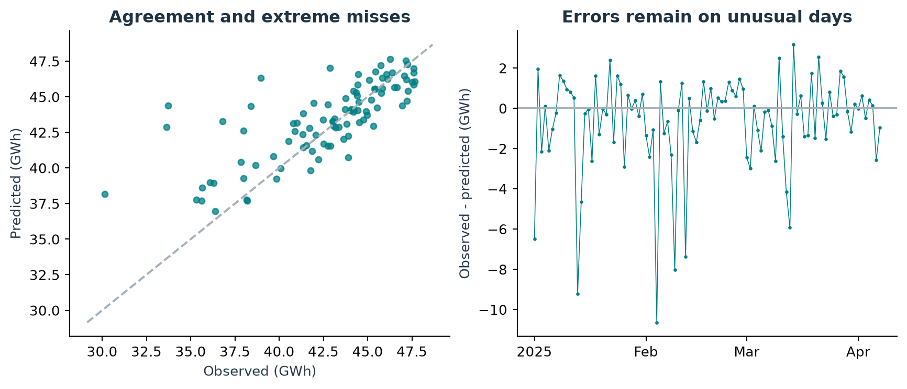
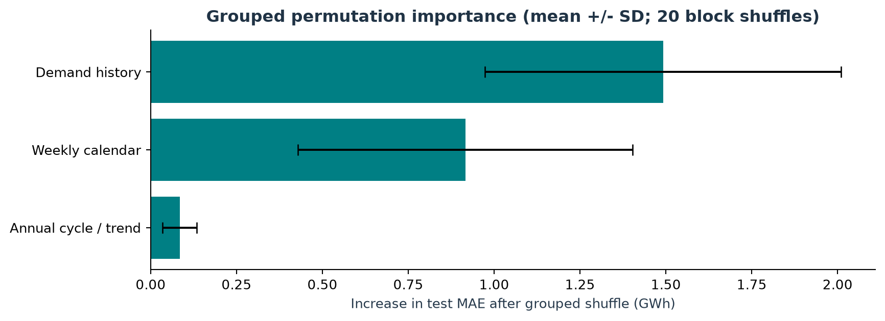
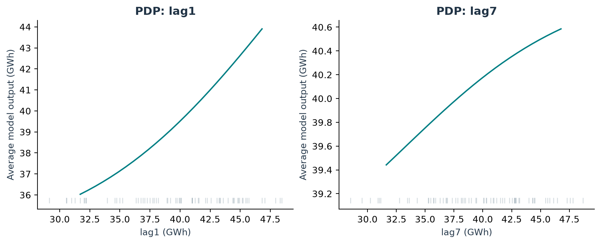
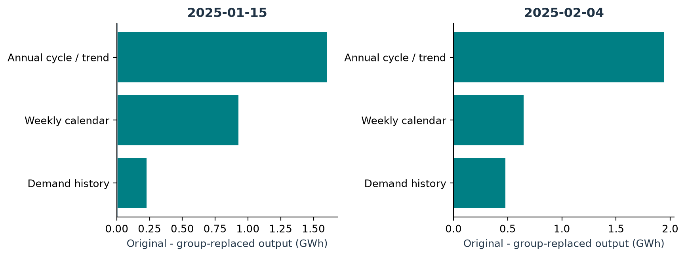

# Forecasting Sri Lankan Recorded Dispatch Energy

## Forecasting Sri Lankan Recorded Dispatch Energy

D.V.S Sandaru Rashmika Index number: 269182L MSc in Artificial Intelligence University of Moratuwa, Sri Lanka IT5514 - Applied Machine Learning Prepared: 28 October 2026

### Abstract

This study evaluates one-day-ahead forecasting of recorded electricity dispatch energy in Sri Lanka using Gaussian Process Regression (GPR), a non-deep-learning algorithm absent from the supplied teaching material. The data are compiled from a versioned public release of PUCSL plant-level dispatch records. A raw-data audit identifies duplicate timestamp/plant keys and a published daily series that omits the documented interval conversion. Energy is therefore reconstructed from deduplicated 15-minute MW readings rather than accepted from the released daily CSV. Quality and lag-availability checks yield 756 modelling days: 659 for development and 97 for chronological testing.

Three expanding validation windows select a Matérn-5/2 kernel. On the frozen January-April 2025 test, GPR achieves MAE 1.599 GWh, RMSE 2.492 GWh and R² 0.544, reducing MAE by 29.7% against a weekly seasonal-naïve forecast. SVR has lower test MAE and random forest lower RMSE; paired block resampling does not establish GPR superiority over random forest. Nominal 95% observation intervals cover 92.8% of outcomes. Grouped permutation importance and retrained ablations identify demand history and weekly calendar structure as useful, while local sensitivity analysis exposes reference dependence. Large errors coincide with several public holidays omitted from the frozen predictors. The resulting interface is a historical research prototype; limitations in data coverage, forecast-time availability and uncertainty prevent an operational grid-control claim.

Keywords: Sri Lanka; dispatch energy; Gaussian processes; temporal validation; explainable machine learning; uncertainty.

Review status: AI-assisted research draft for student review and defence. Assistance and unresolved institutional-policy checks are disclosed on page 15. This report contains executed experimental results, rather than illustrative performance values.

## 1. Problem and local data

### 1.1 Research question and practical relevance

Can GPR improve a simple weekly forecast of the next local day’s recorded dispatch energy, while supplying interpretable feature-reliance evidence and useful uncertainty information? Electricity planning benefits from anticipating daily energy requirements, but a forecasting study must distinguish measured dispatch from end-use consumption and from demand that might have been curtailed. This assignment investigates a carefully delimited dispatch proxy, rather than claiming to recover unconstrained national demand.

CEB reports average daily net generation of 45.9 GWh in 2024 [11]. The selected API subset reconstructs an average 42.136 GWh/day for that year. These are different measurement scopes; the discrepancy is a warning against relabelling this dataset as a complete national consumption census. The project’s practical contribution is a reproducible local forecasting and data-quality study, supported by a demonstrable interface.

### 1.2 Collection and provenance

The study retrieves the Sri Lankan raw subset from Coombes, Hunt and Bloomfield’s SASEA dataset, Zenodo record 17175212, version v1, published 22 September 2025 [2]. Its original producer is PUCSL. The compilers document retrieval of plant-level dispatch power through PUCSL’s actual-system-dispatch API [2], [3]. The student’s contribution is secondary acquisition, auditing, compilation and modelling, not original electricity measurement. Retrieval on 28 October 2026 is pinned by the archive MD5 and extracted-file SHA-256 in the provenance record. The verified licence is CC BY 4.0; attribution and changes are documented.

| Raw field | Meaning | Unit / type |
| --- | --- | --- |
| timestamp | UTC observation timestamp | ISO-8601 |
| powerPlantId | Opaque generating-unit identifier | Integer |
| dispatchValueInMW | Recorded plant dispatch power | MW; may be null or negative |

The raw file has 2,902,337 rows and 44 plant identifiers across the record. Its local timestamps run from 1 January 2023 at 05:30 to 8 April 2025 at 05:30, Asia/Colombo. The source YAML contains placeholder DOIs and inconsistent textual year ranges; measured timestamps and the minted Zenodo record resolve these discrepancies. The pinned upstream archive remains unchanged.

### 1.3 Ethical scope

The selected variables concern aggregate generating units, not identifiable households or patients. No personal or sensitive records are collected. Reuse still requires accurate attribution, faithful descriptions of coverage, and restraint about public policy or operational decisions. National aggregation cannot support individual-level fairness claims.

## 2. Reconstructing a defensible target

UTC timestamps are converted before deriving local dates. Duplicate timestamp/plant keys are checked for conflicting values: none are found. Removing 29,875 identical repeated keys leaves 79,489 distinct timestamps. At each timestamp, observed plant MW values are summed and integrated over a 15-minute interval. Missing readings are not silently certified as zero.

```text
E(t) [MWh] = 0.25 × sum over 96 intervals q of sum over recorded plants p of MW(p,q)
```

A target day is eligible only with exactly 96 distinct intervals and no explicit null plant values. The two partial boundary days have 74 and 23 intervals and are excluded. Twelve additional days contain explicit missing readings. This leaves 815 eligible target dates. Reindexing to a complete daily calendar before constructing shifted histories prevents a missing day from being mistaken for a one-day lag. Removing rows without all required past values leaves 756 modelling rows; targets are never interpolated.



The released daily CSV equals the local-day sum of raw, undeduplicated MW readings exactly (maximum absolute difference 0). Its median ratio to reconstructed MWh is 4.041427. This provides direct evidence that the published values omit the documented 0.25-hour conversion and include duplicate keys. Dividing that CSV by four would retain duplicate inflation. On 24 December 2024, reconstruction gives 41.668 GWh, compared with PUCSL’s 41.96 GWh excluding non-telemetered generation and 44.92 GWh including estimates [9]. This supports the scale, while preserving a coverage caveat.

Small negative readings and ten all-zero system intervals are retained. Zero periods may represent interruption or telemetry failure; the values alone cannot resolve the cause. Clipping all negative readings would add 549.25 MWh over the full record, with a maximum daily change of 39 MWh. No extreme test target is removed to improve performance.

## 3. Why Gaussian Process Regression?

### 3.1 Evidence that the method is new to this course material

The supplied-material audit covers 38 files, including 1,214 PDF pages, 278 notebook cells, Office documents and a project slide image. Text extraction, OCR of low-text pages, binary-PowerPoint extraction and notebook-source review identify the taught model families. LightGBM and CatBoost are explicitly present; the Week 7 XAI note also discusses generalized additive models and explainable boosting machines. GPR is absent from the extracted/OCR material. Gaussian basis functions in linear regression and Gaussian mixture clustering are distinct techniques. This supports eligibility against the supplied evidence, while leaving unsupplied classroom discussion outside the audit.

### 3.2 Model and assumptions

GPR places a Gaussian prior over function values and conditions it on observations [4]. Similar standardized feature vectors have related outputs through a covariance kernel. This differs from fitting a fixed linear mean, partitioning feature space with trees, averaging forest predictions, or fitting the epsilon-insensitive objective used by SVR. Sharing a kernel family with SVM does not make the inferential objective or predictive distribution the same. GPR is appropriate here because the filtered daily table is small enough for exact inference and the study benefits from an uncertainty estimate.

```text
f ~ GP(0, k);  y = f(X) + ε;  ε ~ N(0, σ²_n I)
K_y = K(X,X) + σ²_n I
μ_* = k_*ᵀ K_y⁻¹ y
var(y_*) = k(x_*,x_*) - k_*ᵀ K_y⁻¹ k_* + σ²_n
```

The implementation standardizes predictors using training data and normalizes the training target internally [5]. Cholesky solves are used instead of forming a matrix inverse explicitly. The equations show the normalized-space model; predictions are returned in MWh. A white-noise kernel represents observation noise, and a small diagonal jitter of 10⁻⁶ stabilizes the covariance matrix.

### 3.3 Kernel choice and tradeoffs

The search compares RBF, Matérn-3/2 and Matérn-5/2 signal kernels, each multiplied by a learned constant and added to white noise. A shared scalar length scale limits search complexity after feature scaling. Matérn-5/2 uses k(r) = σ²_f [1 + √5r/ℓ + 5r²/(3ℓ²)] exp(-√5r/ℓ). Smoothness, Gaussian noise, stationarity in transformed feature space and fixed hyperparameters remain assumptions, rather than established properties of the electricity system.

Exact GPR has cubic training cost and quadratic covariance storage in sample size. It becomes unattractive for millions of interval rows, motivating the daily task rather than indiscriminate full-resolution fitting. Its uncertainty is conditional on this kernel and fitted parameters; it does not automatically include structural shifts, missing plants or unknown publication delays.

## 4. Features and temporal validation

### 4.1 Forecast timing and leakage prevention

For target day t, predictions use only completed readings from t-1 or earlier and known calendar attributes of t. This assumes full previous-day telemetry is available at the forecast origin. Actual publication latency has not been verified, so the experiment is retrospective. During validation and testing, parameters remain fixed within each evaluation window, while yesterday’s observed outcome becomes a permissible input for the next day. This is a rolling-input, one-day-ahead evaluation; it is not a multi-month forecast issued at one fixed origin.

| Predictor group | Construction | Count |
| --- | --- | --- |
| Demand history | E(t-1), E(t-2), E(t-7), E(t-14) | 4 |
| Recent level and variability | Mean and population SD over t-7 ... t-1 | 2 |
| Weekly calendar | sin and cos of 2π × weekday/7 | 2 |
| Annual cycle | sin and cos of 2π × (day-of-year - 1)/365.2425 | 2 |
| Trend | Calendar days since 1 January 2023 | 1 |

There are no categorical raw predictors to encode. Cyclic transforms avoid treating Sunday and Monday as far apart. No same-day dispatch, contemporaneous weather, target-derived ratios or future rolling totals enter the predictors. Scaling is refitted inside every training fold, and test data never enter scaling, kernel fitting, model selection or interval recalibration.

### 4.2 Calendar-based expanding validation

| Fold | Train through | Validation dates | Train / validation rows |
| --- | --- | --- | --- |
| 1 | 31 Mar 2024 | 1 Apr-30 Jun 2024 | 395 / 80 |
| 2 | 30 Jun 2024 | 1 Jul-30 Sep 2024 | 475 / 92 |
| 3 | 30 Sep 2024 | 1 Oct-31 Dec 2024 | 567 / 92 |
| Final | 31 Dec 2024 | Test: 1 Jan-7 Apr 2025 | 659 / 97 |

Chronological windows avoid training on future data, as cautioned by temporal validation guidance [6]. Custom date boundaries preserve comparable calendar seasons despite quality-related gaps; this is not an unqualified application of equally spaced TimeSeriesSplit. Each fold uses all eligible earlier rows, starting on 16 January 2023. Mean validation MAE across the three folds is the sole selection criterion. The 80-row first validation period receives the same fold weight as the two 92-row periods, a predeclared choice.

The final split is approximately 87.2% development and 12.8% test among eligible rows. Within development, the first validation fold begins after 395 training rows. A separate random train/validation/test split is inappropriate for this forecasting question. The experiment protocol and selected configurations are saved before test prediction.

## 5. Model selection and reproducibility

### 5.1 Fair and bounded comparisons

Two operationally transparent baselines predict yesterday’s energy (persistence) and the same weekday last week (seasonal naïve). Taught comparators are ordinary linear regression, random forest and RBF SVR. All learned models see the same eleven features and evaluation dates. RF, SVR and GPR each have six candidate configurations; linear regression and the two naïve methods have no search. This controls search opportunity, although it does not guarantee equal representational power or equal optimization difficulty.

| Model | Predeclared search and fixed choices |
| --- | --- |
| Linear regression | Intercept fitted; predictors standardized. |
| Random forest | 300 trees; depth {6, unrestricted}; leaf minimum {2, 5, 10}; seed 42. |
| SVR | RBF kernel, gamma=scale; C {1,10,100}; epsilon {0.05,0.15}; X and y standardized within training. |
| GPR | RBF, Matérn-3/2 or Matérn-5/2; initial length {1,5}; learned signal amplitude, length and noise. |

GPR maximizes training log marginal likelihood within each candidate using L-BFGS-B, limited to 80 iterations. Bounds are signal variance [0.01,100], length [0.1,100] and noise variance [0.0001,2] in normalized units. There are no random optimizer restarts in selection. The selected family is Matérn-5/2, initialized at length 5. Its final fitted signal variance is 4.834, length 8.228 and noise variance 0.185. No convergence warning is recorded in the candidate fits or selected final fits.

### 5.2 Selected validation results

| Model | Mean validation MAE (GWh) | Selected settings |
| --- | --- | --- |
| Random forest | 1.823 | Unrestricted depth; leaf minimum 5 |
| GPR | 1.998 | Matérn-5/2; initial length 5 |
| SVR | 2.123 | C=1; epsilon=0.05 |
| Linear regression | 2.182 | No tuned hyperparameters |
| Persistence | 2.911 | Lag 1 |
| Seasonal naive | 3.025 | Lag 7 |

Random forest is the best taught comparator selected by validation. GPR’s selected-fold MAEs are 2.315, 2.187 and 1.492 GWh: substantial variation across evaluation periods. Differences between GPR initial lengths are tiny and should not be interpreted as a substantive advantage of the starting value. Complete candidate/fold scores are retained for audit.

## 6. Heldout predictive performance

MAE is primary because it expresses typical absolute error in the planning unit without giving a few extreme errors the quadratic weight of RMSE. RMSE is retained to expose large misses; R² measures squared-error skill relative to the test mean. Baseline skill is 1 - MAE(model)/MAE(seasonal naïve). Metric choice is fixed before evaluation; accuracy and F1 would be inappropriate for this continuous target.

| Model | MAE (GWh) | RMSE (GWh) | R² | MAE skill |
| --- | --- | --- | --- | --- |
| Persistence | 3.255 | 4.243 | -0.323 | -43.1% |
| Seasonal naive | 2.274 | 3.173 | 0.260 | 0.0% |
| Linear regression | 2.043 | 2.805 | 0.422 | 10.2% |
| Random forest | 1.607 | 2.322 | 0.604 | 29.3% |
| SVR | 1.534 | 2.406 | 0.574 | 32.5% |
| GPR | 1.599 | 2.492 | 0.544 | 29.7% |



GPR improves seasonal-naïve MAE by 0.675 GWh (29.7%) and persistence MAE by approximately 50.9%. SVR has the lowest test MAE, 1.534 GWh, whereas random forest has the lowest RMSE, 2.322 GWh. GPR’s R² is 0.544: meaningful improvement over a constant test-mean reference, with considerable unexplained variation. The test does not establish that the new method dominates taught models.

Validation and test rankings differ: RF had the lowest validation MAE, but SVR has the lowest test MAE. This is reported descriptively and does not trigger retuning or replacement of the frozen GPR prototype. For point forecasting alone, RF remains the model preferred by the stated validation rule; GPR supplies a probabilistic alternative whose interval quality must also be examined.

## 7. Uncertainty and comparison stability



The predictive intervals use μ ± 1.960σ, where σ includes the fitted white-noise observation component [5]. Coverage is 90/97 = 92.8%, compared with nominal 95%, and mean interval width is 9.340 GWh. Gaussian negative log predictive density is 9.274 using MWh as the target unit; this score changes with units and is useful only in like-for-like probabilistic comparisons. The broad intervals and seven misses argue against presenting the displayed range as an operational guarantee.

Observed coverage below nominal suggests a calibration concern, but 97 temporally related outcomes are insufficient to prove systematic undercoverage by themselves. The fitted Gaussian noise is homoscedastic, hyperparameter uncertainty is omitted, and known exceptional dates can shift the conditional mean. No test-based interval recalibration is performed. Prospective calibration and a wider evaluation period would be needed for decision support.

### 7.1 Paired moving-block bootstrap

| Comparator | Mean GPR-minus-comparator MAE (GWh) | 95% interval, 7-day blocks |
| --- | --- | --- |
| Seasonal naïve | -0.675 | [-1.134, -0.221] |
| Random forest | -0.009 | [-0.188, +0.181] |

Two thousand paired circular moving-block resamples preserve local dependence better than an independent-day bootstrap. Negative differences favour GPR. Fourteen-day-block sensitivity gives [-1.084,-0.257] GWh versus seasonal naïve and [-0.184,+0.168] GWh versus RF. Both block lengths support improvement over the weekly baseline; both include zero against RF. These intervals describe this short test under resampling assumptions and are not a multi-dataset significance claim.

RF seeds 7, 42 and 2026 produce test MAEs 1.631, 1.607 and 1.634 GWh. GPR initial-length multipliers 0.5, 1 and 2 converge to effectively identical fitted kernels and MAEs (difference below 0.002 MWh). These predeclared diagnostics are retained without choosing a better test-scoring run. GPR residual autocorrelations are -0.019 at lag 1 and -0.007 at lag 7; near-zero values do not prove independent errors.

## 8. Errors and Sri Lankan calendar effects



| Date | Observed GWh | GPR GWh | Absolute error GWh |
| --- | --- | --- | --- |
| 4 Feb 2025 | 33.735 | 44.373 | 10.638 |
| 13 Jan 2025 | 33.650 | 42.866 | 9.216 |
| 9 Feb 2025 | 30.152 | 38.173 | 8.021 |
| 12 Feb 2025 | 38.968 | 46.337 | 7.369 |

The largest miss occurs on 4 February, Independence Day. Another occurs on 13 January, Duruthu Full Moon Poya Day, and 12 February is Navam Full Moon Poya Day [10]. The model knows weekday and annual position, but has no explicit Sri Lankan holiday flag. These coincidences support a plausible omitted-calendar explanation; they do not establish a causal attribution or exclude concurrent changes in supply or telemetry. On 9 February, the raw record includes all-zero intervals; a low recorded outcome could reflect physical disruption or data issues.

January, February and March GPR MAEs are 1.657, 1.824 and 1.529 GWh, respectively. The April estimate is 0.746 GWh, based on only seven days; it should not be interpreted as a stable seasonal improvement. The heldout mean actual-minus-predicted residual is -0.683 GWh, indicating aggregate overprediction. Error slices and the ten worst predictions are provided as auditable tables.

Holiday engineering is a strong next experiment because the calendar is knowable in advance. It is deliberately not fitted after diagnosing these test errors. A revised holiday-aware model would require a newly reserved later holdout or a fresh outer validation design. Otherwise the same test would have served both feature selection and final assessment. The original difficult dates remain in every reported main comparison.

## 9. Global explanation and ablation

The official guide accepts feature importance as an explainability method [1]. Grouped permutation importance measures deterioration in heldout MAE when a predictor group is shuffled [7]. The six correlated demand-history variables are moved together; weekday sine/cosine and annual/trend coordinates form two further groups. Twenty shuffles rearrange contiguous seven-day blocks, then apply a random 0-6-day circular phase offset. The offset prevents identical weekday encodings after whole-week permutations.



Demand-history permutation raises MAE by 1.492 GWh on average (SD 0.518), weekly-calendar permutation by 0.916 GWh (SD 0.488), and annual/trend permutation by 0.085 GWh (SD 0.050). Thus the fitted GPR relies most on observed recent level and recurring weekly structure. This is consistent with the development data’s lower weekend dispatch, rather than proof of any economic cause. Low importance for annual/trend features can reflect limited history, redundancy and the short test window, not their universal irrelevance.

### 9.1 Retraining asks a different question

| GPR specification | Test MAE (GWh) | Change from full |
| --- | --- | --- |
| Full eleven features | 1.599 | Reference |
| Demand history only | 2.009 | +0.411 GWh |
| Calendar and trend only | 2.423 | +0.824 GWh |

Ablation models are refitted using the selected kernel family without retuning. Removing calendar/trend worsens MAE; removing history worsens it further. This complements permutation evidence: shuffling tests reliance of a fixed model, whereas retraining measures what a different model can recover from a restricted feature set. The limited search inherited by each ablation prevents claiming that these are optimal reduced-feature models.

Neither grouped shuffling nor retraining proves causality. Blocks retain some local structure but can still produce feature combinations outside the observed joint distribution. Group-level interpretation is preferable to splitting credit arbitrarily among redundant lags, and its limitations remain explicit [8].

## 10. Local effects and their limits



PDPs average GPR predictions after replacing one feature over its development-data 5th-95th percentile range. Both previous-day and previous-week energy have positive average response curves. The displayed response to lag 1 is stronger over its plotted range than that to lag 7, but different ranges and correlated histories prevent interpreting a slope comparison as uniquely identified importance. PDP extrapolation concerns are particularly relevant when several lags describe the same physical process [8].



The local reference is the actual development row nearest the standardized median vector, preserving valid cyclic coordinates within each reference group. For 15 January 2025, GPR predicts 42.326 GWh. Replacing demand history with the reference group lowers output by 0.226 GWh; replacing weekly calendar lowers it by 0.928 GWh; replacing annual/trend lowers it by 1.603 GWh. The same analysis is shown for 4 February, where the forecast is inaccurate.

These separate replacement differences do not sum to the forecast and are not SHAP values. Changing the reference changes the question, and cross-group hybrids can still be unsupported. A locally large annual/trend difference can coexist with low average permutation importance because the methods measure different quantities. Faithfully describing a mistaken forecast does not validate the forecast, establish fairness or provide causal recourse.

## 11. Critical discussion and practical impact

### 11.1 Data validity and representativeness

The dominant data risk is target meaning. Recorded plants vary from 33 to 42 at individual timestamps, and an absent plant is not a verified zero. Full timestamp coverage does not certify full national generation coverage. Dispatch responds to available supply and network conditions; it cannot independently reveal unsatisfied demand or household consumption. A model trained on this proxy should not be used to calculate household bills, attribute consumption to demographic groups or recommend dispatch set-points.

The raw values are integer-like MW readings with some negatives and zeros. Rectangular 15-minute integration follows the authors’ documented procedure, but uncertainty about instantaneous versus interval-average reporting remains. Excluding explicit-null days protects target integrity while creating selection bias toward better-recorded dates. Dropping rows with unavailable histories may further underrepresent disturbed periods. The retained quality tables allow these exclusions to be inspected rather than hidden.

### 11.2 Validation and model limitations

Only a little over two years of data and one 97-day holdout are available. The test omits most of 2025, including Sinhala and Tamil New Year, and cannot establish robustness to future tariffs, new generating capacity, climate extremes or reporting changes. Three chronological folds are stronger than random shuffling but do not eliminate model-selection uncertainty. Six candidate settings per nonlinear model are a bounded search, not exhaustive optimization. Validation MAE is aggregated equally by fold despite different eligible counts.

GPR is a stationary, smooth model over standardized inputs, with scalar length scale and Gaussian homoscedastic noise. It can smooth abrupt holiday effects and extrapolate poorly as the trend coordinate moves beyond training support. Its probabilistic output adds information but also depends on assumptions that are visibly imperfect on exceptional dates. SVR and RF results demonstrate that algorithm novelty does not guarantee superior point accuracy. A simple, interpretable baseline remains essential to judge whether complexity is useful.

### 11.3 Bias, ethics and consequences

This national aggregate contains no protected attributes; consequently demographic parity or equalized-error claims cannot be measured. Coverage bias may nevertheless reflect where reporting plants and distributed generation are represented. National accuracy can conceal regional shortages and different household experiences. Overprediction could encourage unnecessary energy procurement; underprediction could weaken planning margins. These are potential pathways, not quantified savings or harms demonstrated here. Human operational expertise, verified live inputs and prospective monitoring would be prerequisites for real deployment.

### 11.4 Next evidence to collect

The next study should add verified advance-known Sri Lankan holidays, record actual telemetry publication latency, and obtain forecast weather rather than realized same-day weather. A longer, genuinely untouched future period would test recalibration, seasonal stability and reporting changes. Conditional feature-effect analyses and background-sensitivity checks could strengthen the XAI audit. Local compute already handles this study efficiently; an Azure deployment would add cost and complexity without resolving the central evidence gaps.

## 12. Prototype and reproducible deliverables

### 12.1 An interface connected to the actual fitted model

The local “Lanka Dispatch / Forecast Lab” interface accepts a target date and six demand-history summaries, using GWh for readability. Calendar features are derived from the selected date. A Python HTTP service loads the saved GPR pipeline and returns the actual model mean, observation interval, seasonal-naïve comparison and signed group-replacement sensitivities. The browser contains no mock prediction function. Recorded outcomes are displayed separately for historical replay; editing inputs never rewrites the observed outcome.

Users can load a historical case, edit values, generate a fresh estimate, inspect evaluation evidence, and read the source/quality notes. Negative, non-finite and out-of-range energy inputs are rejected. Out-of-development energy ranges and dates outside the evaluated period generate warnings. The prototype binds only to localhost and uses no external credentials or paid services. A captured-interface walkthrough accompanies the source; its narration is synthesized and disclosed as assistance.

### 12.2 Reproduction workflow

| Stage | Entry point / evidence |
| --- | --- |
| Acquire and prepare | 03_code/prepare_data.py; raw hashes and daily quality table |
| Select and evaluate | 03_code/train_evaluate.py; protocol, complete CV log, saved models and test predictions |
| Explain and plot | 03_code/explain_and_plot.py; grouped shuffle repeats, PDP data, local sensitivities and figures |
| Verify | 03_code/validate_project.py; independent lag and metric checks |
| Demonstrate | 03_code/app.py; local browser interface and API checks |
| Rebuild report | 03_code/build_report.py; editable content JSON and Markdown source |

A notebook runs the same canonical scripts so that its results do not diverge from a separately maintained implementation. The README specifies environment creation, pinned dependencies and launch commands. The source ZIP includes permitted Sri Lankan data, processed tables, source, notebook, model artefacts, logs and explanations, but excludes the virtual environment, other countries’ data, copied teaching materials, credentials and scratch files. The separate PDF and 3-5 minute video satisfy the guide’s listed submission formats [1].

Verification checks independently reconstruct lags and rolling histories, enforce chronological separation, confirm development-only scaling and GP training size, reproduce saved predictions, recompute every main metric, and confirm validation-only candidate selection. An isolated reproduction checks the packaged workflow. Student review, applicable AI rules and Moodle upload remain human actions.

## References

[1] University of Moratuwa, “Machine Learning Assignment - Guidelines,” IT5514 supplied assignment brief, n.d., 2 pp.

[2] O. G. Coombes, K. Hunt and H. Bloomfield, “SASEA Electricity Demand Data for 2013-2025,” Zenodo, v1, 22 Sep. 2025. doi: 10.5281/zenodo.17175212. Available: https://doi.org/10.5281/zenodo.17175212

[3] O. G. Coombes, K. M. R. Hunt and H. C. Bloomfield, “Open-access energy demand data for South and Southeast Asia,” Earth System Science Data Discussions, preprint, 2026. doi: 10.5194/essd-2026-76. Available: https://essd.copernicus.org/preprints/essd-2026-76/ . Cited as a preprint, not a confirmed peer-reviewed final article.

[4] C. E. Rasmussen and C. K. I. Williams, Gaussian Processes for Machine Learning. Cambridge, MA: MIT Press, 2006, ch. 2. Available: https://gaussianprocess.org/gpml/chapters/RW2.pdf

[5] scikit-learn developers, “Gaussian Processes” and “GaussianProcessRegressor,” scikit-learn 1.9.1 documentation. Available: https://scikit-learn.org/stable/modules/gaussian_process.html and https://scikit-learn.org/stable/modules/generated/sklearn.gaussian_process.GaussianProcessRegressor.html

[6] scikit-learn developers, “TimeSeriesSplit,” scikit-learn 1.9.1 documentation. Available: https://scikit-learn.org/stable/modules/generated/sklearn.model_selection.TimeSeriesSplit.html

[7] scikit-learn developers, “Permutation feature importance,” scikit-learn 1.9.1 documentation. Available: https://scikit-learn.org/stable/modules/permutation_importance.html

[8] G. Hooker, L. Mentch and S. Zhou, “Unrestricted Permutation forces Extrapolation: Variable Importance Requires at least One More Model, or There Is No Free Variable Importance,” arXiv:1905.03151v2, 2021. Available: https://arxiv.org/abs/1905.03151

[9] Public Utilities Commission of Sri Lanka, Daily Electricity Generation & Cost Estimation Report: 24th December 2024. Available: https://www.pucsl.gov.lk/wp-content/uploads/2024/12/Generation-Cost-24th-Dec_2024-R.pdf

[10] Central Bank of Sri Lanka, “Bank Holidays for 2025.” Available: https://www.cbsl.gov.lk/en/about/about-the-bank/bank-holidays-2025

[11] Ceylon Electricity Board, Sales & Generation Data Book - 2024, p. 2. Available: https://www.ceb.lk/front_img/img_reports/1763693550Sales_and_Generation_Data_Book_2024.pdf

[12] University of Moratuwa Library, “Plagiarism Support.” Available: https://www.uom.lk/lib/plagiarism-support-0

Online sources were checked on 28 October 2026. The verified source register records URLs, dates, source role and relevant evidence. Supplied lecture notes and the personal open-book guide inform course-coverage checking; their exercises do not replace the official assessment brief. No unverified source DOI or citation placeholder is used.

## Assistance, review and student responsibility

### AI assistance disclosure

OpenAI Codex assisted with reading and extracting the supplied materials, web research and source verification, dataset acquisition, experimental design, Python implementation, local execution, result checking, visualizations, report drafting, the interface and demo preparation. The code was run on the student’s MacBook; reported scores come from the saved experimental outputs. The demo uses a synthesized system voice and captured states of the working interface. These contributions are disclosed so that the work is not represented as unaided authorship.

The dataset authors and original producer retain credit for data collection. Source scripts were consulted for provenance, while this project implements its own reconstruction and modelling workflow. No claim is made that the student personally collected original measurements, independently authored every sentence or manually performed each execution step.

### Academic-integrity boundary

The supplied brief and notes do not state an AI-specific assessment rule, and the student reports no additional instructions. University of Moratuwa’s published plagiarism guidance requires full acknowledgement of others’ work [12]. Absence of an AI-specific statement in the supplied material is not evidence of blanket permission. This draft requires student review and compliance with any programme, module or submission declaration. No independent-work declaration has been signed or fabricated.

### What the student must understand before submission

The student should be able to explain why MW must be integrated into MWh; demonstrate the raw-data discrepancy; distinguish recorded dispatch from end-use demand; reconstruct lagged features by date; describe the GP posterior and Matérn kernel; explain why scaling is confined to each training fold; and distinguish a rolling-input forecast from a fixed-origin multi-step forecast.

The student should also defend the use of temporal baselines, the validation-only selection rule, the absence of a GPR superiority claim over RF, the meaning and limitations of 92.8% interval coverage, the difference between permutation and retrained ablation, and why local group sensitivities are non-additive and non-causal. The accompanying defence guide provides focused questions and code locations for practice.

### Remaining human actions

Read and revise this draft in the student’s own understanding; confirm the lecturer’s acceptance of GPR as a method outside supplied lecture coverage and any AI-use declaration; check the precise Moodle cutoff on 1 November 2026 and upload limits; review the demo and decide whether to rerecord personal narration; and upload the verified submission files. This package does not claim that Moodle upload, lecturer approval or an institutional plagiarism/AI review has occurred.

The completed technical checks and their evidence are recorded separately from these human actions. No fabricated score, execution log, consent record, deployment or approval is included.
